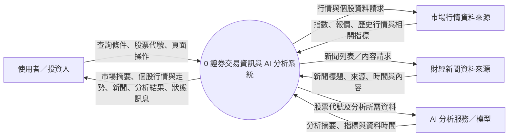
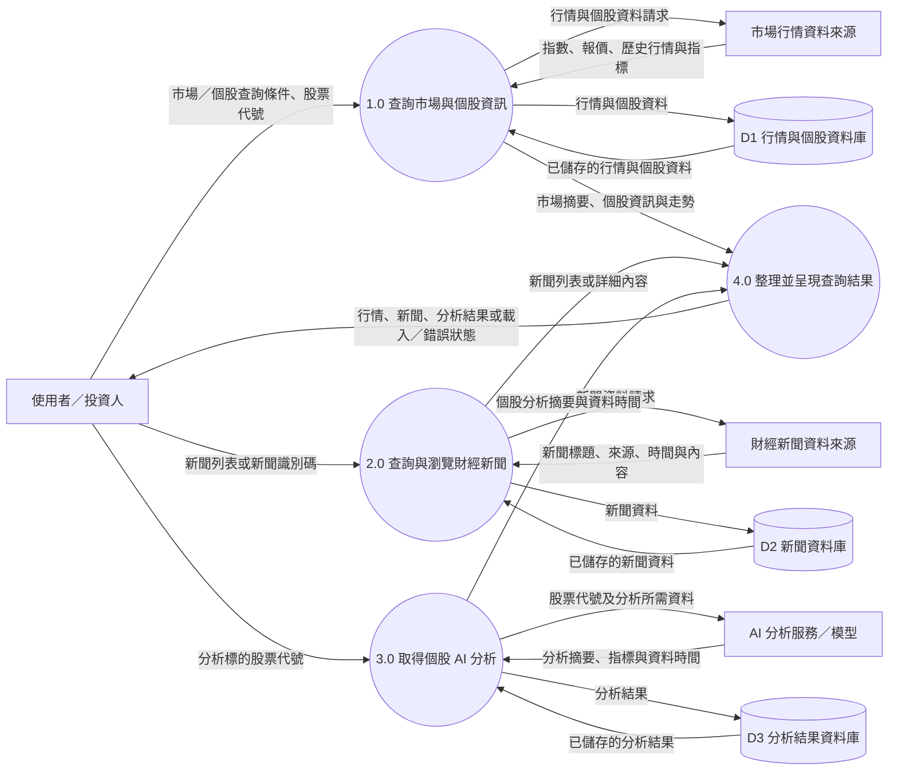

# 證券交易資訊與 AI 分析系統：資料流程圖（DFD）

本系統提供台灣股票市場資訊、個股行情與歷史資料、財經新聞及 AI 分析結果；不處理實際下單。圖中外部資料來源為系統邊界之外的服務，資料儲存表示後端可查詢的資料庫。

## 系統環境圖（Context Diagram）

將整個證券交易資訊與 AI 分析系統視為單一程序，呈現系統與外部實體之間的主要資料交換。

## DFD 圖0（Level 0）

將系統分解為四個主要程序，並標示外部實體、資料儲存與程序間的資料流。程序編號及流向與系統環境圖的整體範圍一致。

## 圖例與範圍

- 方框：外部實體；圓形：處理程序；圓柱：資料儲存；箭頭：資料流。
- 市場與新聞資料來源及 AI 分析服務位於本系統邊界外；資料庫由後端服務管理，前端透過 API 取得結果。
- 系統僅查詢及呈現資訊與分析結果，不建立交易委託、不執行買賣。
