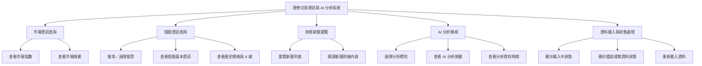
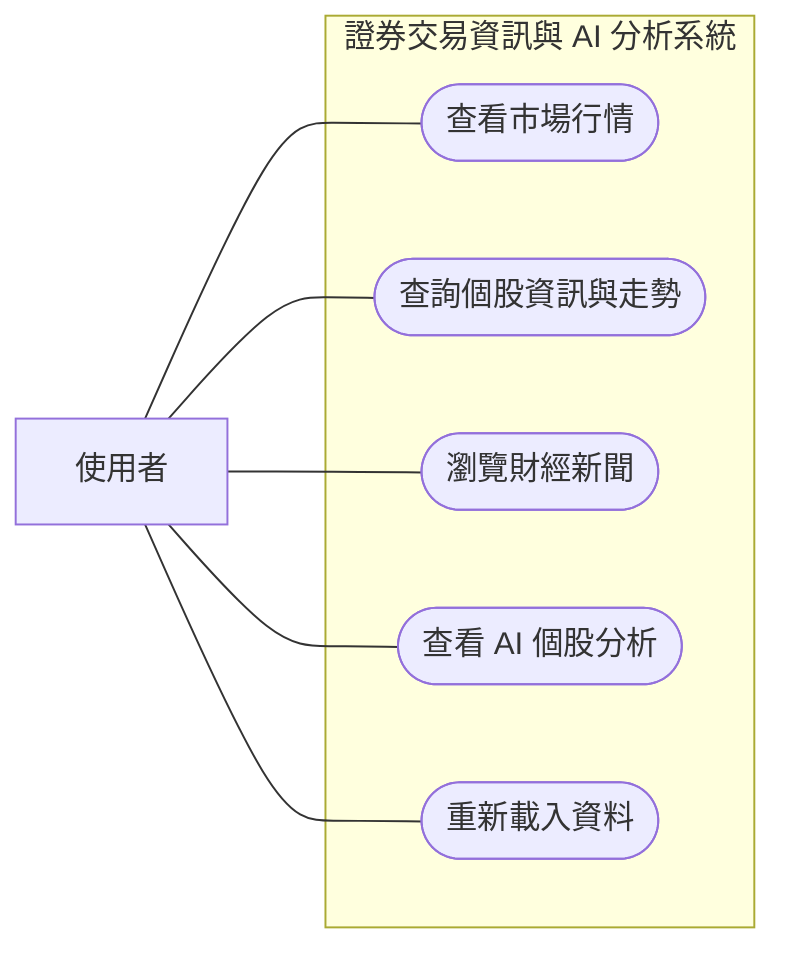

# 小組作業 3：需求分析與使用案例

## 專題：量化交易

本系統提供台灣股票市場資訊查詢、個股行情與歷史走勢檢視、財經新聞閱讀及 AI 分析結果呈現。系統顯示的資料與分析結果供使用者參考，不執行實際下單。

## 一、功能性需求

| 編號 | 需求 |
| --- | --- |
| 1 | 使用者可在市場首頁查看加權指數等市場摘要及最新行情資料。 |
| 2 | 使用者可搜尋或選擇個股，查看個股基本資訊、價格指標、歷史價格及 K 線圖。 |
| 3 | 使用者可瀏覽財經新聞列表，並開啟單篇新聞查看詳細內容。 |
| 4 | 使用者可選擇個股查看 AI 分析摘要與相關指標；系統須標示分析所屬標的及資料時間。 |
| 5 | 當資料載入失敗或查無資料時，系統須顯示清楚的錯誤或空狀態訊息，並提供重新載入方式。 |

## 二、非功能性需求

| 編號 | 需求 |
| --- | --- |
| 1 可用性 | 主要頁面須提供一致的導覽方式；常用功能應能由導覽列直接到達。 |
| 2 效能 | 在一般網路環境下，常用頁面應於 3 秒內顯示主要版面；資料載入期間須提供載入狀態。 |
| 3 相容性 | 前端介面須支援近期版本的 Chrome、Edge 與 Firefox，並可在桌面及手機瀏覽器使用。 |
| 4 安全性 | 系統不得在前端程式碼中暴露資料庫密碼或 API 私密金鑰；外部資料與錯誤訊息不得洩漏機敏設定。 |
| 5 正確性與可理解性 | 行情與分析結果須標示資料日期／時間及適用股票；數值須使用一致的格式與單位。 |

## 三、功能分解圖（Functional Decomposition Diagram, FDD）

## 四、使用案例圖

## 五、使用案例說明

### UC-1：查詢個股資訊與走勢

| 欄位 | 說明 |
| --- | --- |
| 主要角色 | 使用者 |
| 目標 | 查看指定股票的基本資訊、行情指標與歷史走勢。 |
| 前置條件 | 系統可正常連線至行情資料服務。 |
| 觸發條件 | 使用者從導覽進入個股頁，或選擇一檔股票。 |
| 基本流程 | 1. 系統顯示可查詢的個股頁面。 2. 使用者搜尋或選擇股票。 3. 系統向資料服務取得該股票資料。 4. 系統呈現基本資訊、行情指標、歷史價格及 K 線圖。 |
| 替代／例外流程 | 若查無該股票或資料服務無回應，系統顯示說明訊息；使用者可更換股票或重新載入。 |
| 後置條件 | 個股資料與走勢顯示於頁面，或頁面呈現可理解的錯誤狀態。 |

### UC-2：瀏覽財經新聞

| 欄位 | 說明 |
| --- | --- |
| 主要角色 | 使用者 |
| 目標 | 瀏覽新聞列表並閱讀指定新聞內容。 |
| 前置條件 | 系統可正常連線至新聞資料服務。 |
| 觸發條件 | 使用者進入新聞頁面。 |
| 基本流程 | 1. 系統取得並顯示新聞列表。 2. 使用者選擇一則新聞。 3. 系統顯示該新聞的標題、來源、日期與詳細內容。 4. 使用者可返回列表繼續瀏覽。 |
| 替代／例外流程 | 若沒有新聞資料，系統顯示目前無資料；若載入失敗，系統顯示錯誤訊息及重新載入方式。 |
| 後置條件 | 使用者看到新聞列表或所選新聞的詳細內容。 |

### UC-3：查看 AI 個股分析

| 欄位 | 說明 |
| --- | --- |
| 主要角色 | 使用者 |
| 目標 | 查看指定個股的 AI 分析摘要及其參考資料時間。 |
| 前置條件 | 系統已提供該個股的分析結果；分析服務可正常連線。 |
| 觸發條件 | 使用者進入 AI 分析頁面並選擇分析標的。 |
| 基本流程 | 1. 系統顯示可選擇的個股或分析標的欄位。 2. 使用者選擇股票。 3. 系統取得該股票的分析結果。 4. 系統呈現分析摘要、相關指標及資料時間。 5. 使用者可切換其他股票查看分析。 |
| 替代／例外流程 | 若該股票尚無分析結果，系統提示目前無可用分析；若服務失敗，系統顯示錯誤狀態並提供重新載入方式。 |
| 後置條件 | 使用者看到指定股票的分析資訊，或得知目前無法取得分析結果。 |

### UC-4：查看市場行情

| 欄位 | 說明 |
| --- | --- |
| 主要角色 | 使用者 |
| 目標 | 快速了解市場指數與市場摘要。 |
| 前置條件 | 系統可正常連線至市場行情資料服務。 |
| 觸發條件 | 使用者開啟市場首頁。 |
| 基本流程 | 1. 系統取得市場指數及摘要資料。 2. 系統顯示指數數值、漲跌資訊及資料時間。 3. 使用者可從首頁前往個股或分析頁面。 |
| 替代／例外流程 | 若資料尚未更新或服務無回應，系統清楚標示載入失敗或資料時間，並提供重新載入方式。 |
| 後置條件 | 市場摘要呈現於首頁，或系統顯示資料無法取得的狀態。 |

## 範圍說明

本專題目前定位為股票資訊查詢與分析展示前端；使用者不建立交易委託，也不透過本系統買賣證券。AI 分析僅供參考，不構成投資建議。
